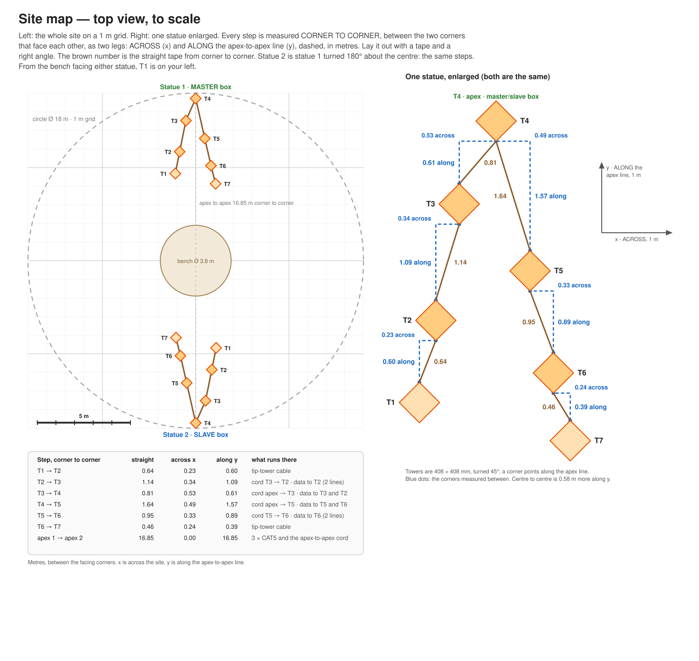

# Midburn LED Statues

Two statues, each a V of 7 towers lit from inside with WS2812B strips behind CNC-cut,
diffused faces, run as one show from a single controller. Controlled from a phone over the
controller's own WiFi; no internet needed.

**Layout tool:** [mrmil.github.io/led-over-rj245](https://mrmil.github.io/led-over-rj245/) — 3D
view of the two statues from the bench, from behind, from above and from a drone, with the tower
heights, spacings, the pictures cut into the faces over the LEDs, DXF files for the laser cutter,
and the LED and power-supply counts. Export the JSON from it into
[`layout/`](layout/statue-layout.json).

<!-- META-DOCS:BEGIN -->
## Documentation

The design of this project, and the reasoning behind it, lives in [`docs/`](docs/README.md) — a
recursive tree that mirrors the system part by part, down to individual behaviours, with every
decision recorded alongside the reason it was made. Start at the hub and navigate down.

These docs are written for LLM coding agents. Design changes are documented in the same commit that
makes them; see [`docs/CONVENTIONS.md`](docs/CONVENTIONS.md).
<!-- META-DOCS:END -->

## Guide

| | |
|---|---|
| [Setup](guide/setup.md) | Numbering, connections, order of work, teardown |
| [Operating](guide/operating.md) | WiFi, preset numbering, checking a tower, settings not to touch |
| [Troubleshooting](guide/troubleshooting.md) | Symptom → check, spares |
| [Wiring](guide/wiring.md) | Diagrams and pin tables: master and slave boxes, power boxes, tip-tower cable, power |
| [Parts](guide/parts.md) | Bill of materials, spares |
| [Inventory](guide/inventory.md) | What exists, counted: boxes, strips, every cable by length, spares |
| [Build](guide/build.md) | Strip cut list, workshop assembly, configuring WLED, backup and restore |

## System

- One ESP32 running [WLED](https://kno.wled.ge), in the master box at statue 1, drives
  14 channels: one per tower.
- Statue 1's towers are wired from the master box. Statue 2's 7 channels cross to the slave box
  as RS-485 on 3 buried CAT5 cables, 3 channels per cable.
- Each tower has 4 strips, one per face, all showing the same pixels, each on its own
  3-pin LED connector.
- Each statue has five 5 V power boxes, fed with mains from its apex: a **1 tower power box** in
  each of T3 and T5, a **2 tower power box** in each of T2 and T6, and the one in T4 inside the
  master/slave box. Each box splits its own tower's channel to the 4 strands; a 2 tower power box also
  feeds the tip tower next to it (T1, T7) through one cable that ends in the tip tower's 4
  LED connectors. Only data and ground cross between the statues.
- The controller runs its own WiFi access point at `http://4.3.2.1`. The password comes from
  the installation lead.
- The RJ45 ports on the boxes are not Ethernet: never plug the cables into network equipment
  or PoE. It will fry the electronics in the boxes and this is unfixable.

## Site map

Every step is measured **corner to corner**, between the two corners that face each other,
as two legs you can lay out with a tape and a right angle: **across** the site (x) and
**along** the line between the two apexes (y). Every tower is turned 45°, so one corner
points at the next tower along that line. Statue 2 is statue 1 turned 180° about the
centre, so the steps are the same at both. From the bench facing either statue, T1 is on
your left.

| Step, corner to corner | Straight | Across | Along |
|---|---|---|---|
| T1 → T2 | 0.64 m | 0.23 m | 0.60 m |
| T2 → T3 | 1.14 m | 0.34 m | 1.09 m |
| T3 → T4 | 0.81 m | 0.53 m | 0.61 m |
| T4 → T5 | 1.64 m | 0.49 m | 1.57 m |
| T5 → T6 | 0.95 m | 0.33 m | 0.89 m |
| T6 → T7 | 0.46 m | 0.24 m | 0.39 m |
| apex 1 → apex 2 | 16.85 m | 0 | 16.85 m |

Centre to centre is 0.58 m more along y than corner to corner. The positions come from
[`layout/statue-layout.json`](layout/statue-layout.json); the
[layout tool](https://mrmil.github.io/led-over-rj245/) shows the same plan live.

## Repository layout

| Path | What |
|---|---|
| [`guide/`](guide/) | Human documentation: setup, operating, troubleshooting, wiring, parts, build |
| [`guide/img/`](guide/img/) | Wiring diagrams, generated by `tools/wiring_diagrams.py` (don't edit by hand) |
| [`tools/`](tools/) | `wiring_diagrams.py`: regenerates the diagrams from one pin table; `statue_render.html`: the layout tool; `face_art.py`: generates the pictures |
| [`art/`](art/) | The four pictures cut into the faces, one per viewpoint, with previews showing the faces; `art/dxf/` holds the cut file of every plate |
| [`layout/`](layout/) | The layout handoff file from the tool, pictures included |
| [`docs/`](docs/README.md) | Design decisions and their reasons (for whoever changes the design) |
| [`TODO.md`](TODO.md) | Open measurements, tests and build tasks |

The enclosures are designed and generated in a separate repository,
[MrMil/electronics-enclosure](https://github.com/MrMil/electronics-enclosure): `100W-masterbox`
for both boxes.
