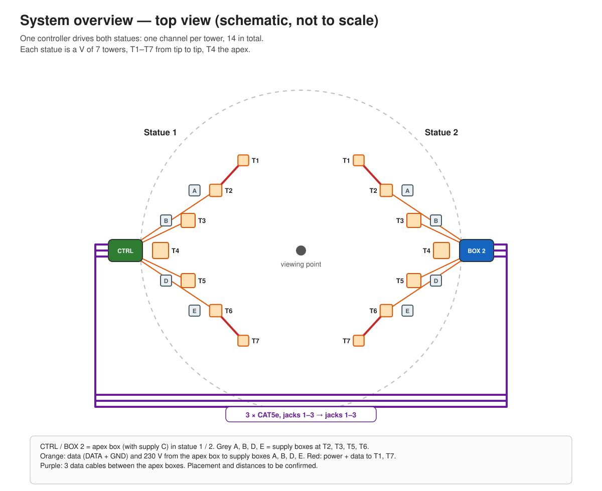

# Midburn LED Statues

Two statues, each a V of 7 towers lit from inside with WS2812B strips behind CNC-cut,
diffused faces, run as one show from a single controller. Controlled from a phone over the
controller's own WiFi; no internet needed.

**Layout tool:** [mrmil.github.io/led-over-rj245](https://mrmil.github.io/led-over-rj245/) — 3D
view of the two statues from the bench, from behind, from above and from a drone, with the tower
heights, spacings, the pictures cut into the faces over the LEDs, DXF files for the laser cutter,
and the LED and power-supply counts. Export the JSON from it into
[`layout/`](layout/statue-layout.json).

<!-- META-DOCS:BEGIN -->
## Documentation

The design of this project, and the reasoning behind it, lives in [`docs/`](docs/README.md) — a
recursive tree that mirrors the system part by part, down to individual behaviours, with every
decision recorded alongside the reason it was made. Start at the hub and navigate down.

These docs are written for LLM coding agents. Design changes are documented in the same commit that
makes them; see [`docs/CONVENTIONS.md`](docs/CONVENTIONS.md).
<!-- META-DOCS:END -->

## Guide

| | |
|---|---|
| [Setup](guide/setup.md) | Numbering, connections, order of work, teardown |
| [Operating](guide/operating.md) | WiFi, test presets, preset numbering, settings not to touch |
| [Troubleshooting](guide/troubleshooting.md) | Symptom → check, spares |
| [Wiring](guide/wiring.md) | Diagrams and pin tables: apex boxes, supply boxes, neighbour bases, power |
| [Parts](guide/parts.md) | Bill of materials, spares |
| [Build](guide/build.md) | Strip cut list, workshop assembly, configuring WLED, backup and restore |

## System

- One ESP32 running [WLED](https://kno.wled.ge), in the controller box at statue 1, drives
  14 channels: one per tower.
- Statue 1's towers are wired from the controller box. Statue 2's 7 channels cross to box 2
  as RS-485 on 3 buried CAT5e cables, 3 channels per cable.
- Each tower has 4 strips, one per face, all showing the same pixels, each on its own
  JST-SM.
- Each statue has five 5 V supply boxes, fed with mains from its apex: A at T2, B at T3, C
  in the apex box, D at T5, E at T6. Each box splits its own tower's channel to the 4
  strands; A and E also feed the tip towers (T1, T7) over XT60. Only data and ground cross
  between the statues.
- The controller runs its own WiFi access point at `http://4.3.2.1`. The password comes from
  the installation lead.
- The CAT5e cables are not Ethernet: never connect them to network equipment or PoE.

## Repository layout

| Path | What |
|---|---|
| [`guide/`](guide/) | Human documentation: setup, operating, troubleshooting, wiring, parts, build |
| [`guide/img/`](guide/img/) | Wiring diagrams, generated by `tools/wiring_diagrams.py` (don't edit by hand) |
| [`tools/`](tools/) | `wiring_diagrams.py`: regenerates the diagrams from one pin table; `statue_render.html`: the layout tool; `face_art.py`: generates the pictures |
| [`art/`](art/) | The four pictures cut into the faces, one per viewpoint, with previews showing the faces; `art/dxf/` holds the cut file of every plate |
| [`layout/`](layout/) | The layout handoff file from the tool, pictures included |
| [`docs/`](docs/README.md) | Design decisions and their reasons (for whoever changes the design) |
| [`TODO.md`](TODO.md) | Open measurements, tests and build tasks |

The enclosures are designed and generated in a separate repository,
[MrMil/electronics-enclosure](https://github.com/MrMil/electronics-enclosure): `100W-masterbox`
for both boxes.
