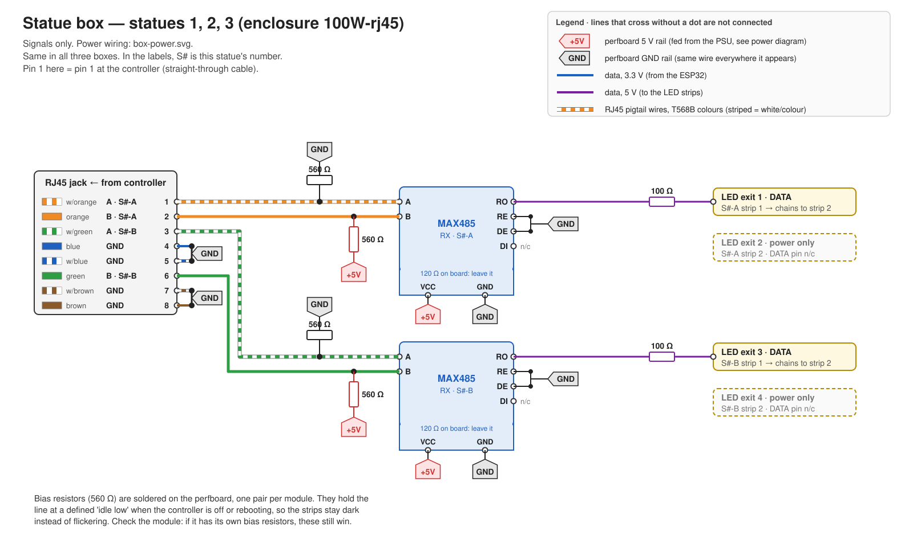
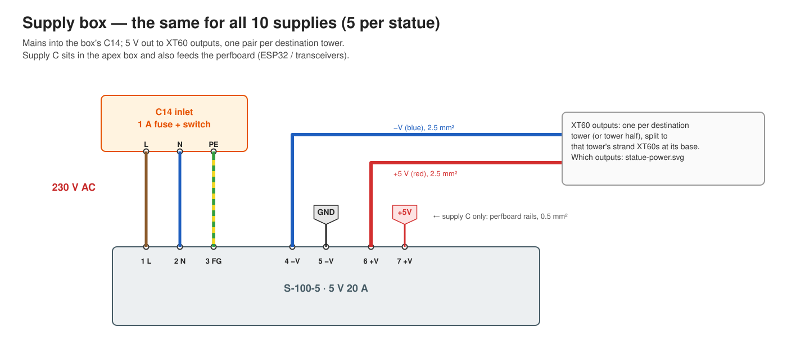

# Wiring

[← README](../README.md) · [Setup](setup.md) · [Build](build.md)

Four diagrams cover every connection.

| Diagram | Covers |
|---|---|
| [System overview](img/overview.svg) | Which cable goes where between the statues |
| [Controller box](img/controller-wiring.svg) | Statue 0: ESP32, level shifter, 6 transmitters, 3 jacks, 4 LED exits |
| [Statue box](img/statue-wiring.svg) | Statues 1 to 3: jack, 2 receivers, 4 LED exits |
| [Box power](img/box-power.svg) | All four boxes: mains inlet, power supply, 5 V to the LED exits and the perfboard |

`+5V` / `GND` flags are the perfboard rails. Crossing lines without a dot are not connected.
RJ45 pigtail wires are drawn in T568B colours (striped = white/colour).

---

## Controller box (statue 0)

### ESP32 pins

| ESP32 pin | Goes to | Ends up at |
|---|---|---|
| 5V / VIN | perfboard +5V | |
| GND | perfboard GND | |
| GPIO 13 | 74AHCT125 pin 2 | LED exit 1 (statue 0, channel A) |
| GPIO 14 | 74AHCT125 pin 5 | LED exit 3 (statue 0, channel B) |
| GPIO 16 | transmitter S1-A, DI | jack 1, pins 1/2 |
| GPIO 17 | transmitter S1-B, DI | jack 1, pins 3/6 |
| GPIO 18 | transmitter S2-A, DI | jack 2, pins 1/2 |
| GPIO 19 | transmitter S2-B, DI | jack 2, pins 3/6 |
| GPIO 23 | transmitter S3-A, DI | jack 3, pins 1/2 |
| GPIO 25 | transmitter S3-B, DI | jack 3, pins 3/6 |

### 74AHCT125 (statue 0's own strips)

| Pin | Connect to |
|---|---|
| 14 (VCC) | +5V |
| 7 (GND) | GND |
| 1, 4, 10, 13 (the four OE) | GND (buffers always on) |
| 2 (1A) | GPIO 13 |
| 5 (2A) | GPIO 14 |
| 3 (1Y) | 100 Ω → DATA of LED exit 1 |
| 6 (2Y) | 100 Ω → DATA of LED exit 3 |
| 9 (3A) and 12 (4A) | GND (unused buffers; an unconnected input can oscillate) |
| 8 (3Y), 11 (4Y) | not connected |

LED exits 2 and 4 carry power only; their DATA pin is not connected in the box.

### MAX485 transmitters (×6)

| Module pin | Connect to |
|---|---|
| VCC | +5V |
| GND | GND |
| DI | its ESP32 GPIO (table above) |
| DE and RE | both to +5V (always transmitting) |
| RO | not connected |
| A, B (screw terminal) | the jack pigtail. See the RJ45 table below. |

Leave the module's own 120 Ω resistor in place.

---

## Statue box (statues 1, 2, 3)

### MAX485 receivers (×2 per box)

| Module pin | Receiver A (exit 1) | Receiver B (exit 3) |
|---|---|---|
| A | jack pin 1 (white/orange) | jack pin 3 (white/green) |
| B | jack pin 2 (orange) | jack pin 6 (green) |
| VCC | +5V | +5V |
| GND | GND | GND |
| DE and RE | both to GND (always receiving) | same |
| DI | not connected | same |
| RO | 100 Ω → exit 1 DATA | 100 Ω → exit 3 DATA |

**Idle bias, per receiver:** a 560 Ω resistor from **A to GND** and another from **B to
+5V**. Without them the strips flicker with random colours whenever the controller is off or
restarting. Leave the module's own 120 Ω resistor in place too.

---

## RJ45 jacks and cables

Same pinout at both ends of every cable. The cables are **straight-through**: pin 1 at one
end is pin 1 at the other.

| Pin | Colour (T568B) | Signal |
|---|---|---|
| 1 | white/orange | channel A, line A |
| 2 | orange | channel A, line B |
| 3 | white/green | channel B, line A |
| 4 | blue | GND |
| 5 | white/blue | GND |
| 6 | green | channel B, line B |
| 7 | white/brown | GND |
| 8 | brown | GND |

Pins 3 and 6 are one twisted pair (T568B green). A and B of a channel must be the same pair.
Verify pin-to-pin with a meter through both jacks; don't rely on colours.

---

## Power (all four boxes)

- **Mains:** inlet L → PSU terminal 1 (L), N → 2 (N), PE → 3 (FG). Workshop job only.
- **Strip power:** PSU terminal 4 (−V) → a 5-way WAGO lever connector → the GND wire of
  each LED exit. PSU terminal 6 (+V) → a second WAGO → the 5V wire of each LED exit.
  1.5 mm² wire from PSU to WAGO.
- **Perfboard power:** PSU terminal 5 (−V) → perfboard GND rail, terminal 7 (+V) →
  perfboard +5V rail. 0.5 mm² wire.
- The perfboard carries **data only** to the LED exits, never strip current. Its copper is
  too thin for amps.

Each JST LED exit is rated **3 A**, and these four exits are the statue's only power. The
brightness limit in the controller keeps every exit under 3 A.

---

## Notes

- Ferrules on stranded wire in screw terminals; stray strands short A to B. No tinned ends.
- Zip-tie the pigtails inside each box.
- Label box number, jack numbers and exit numbers on the outside of each box.
- MAX483/487/488/489 lookalikes are too slow for LED data; the chip must read MAX485.
