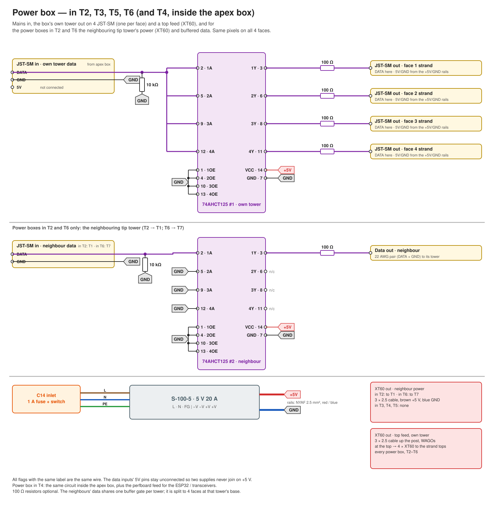
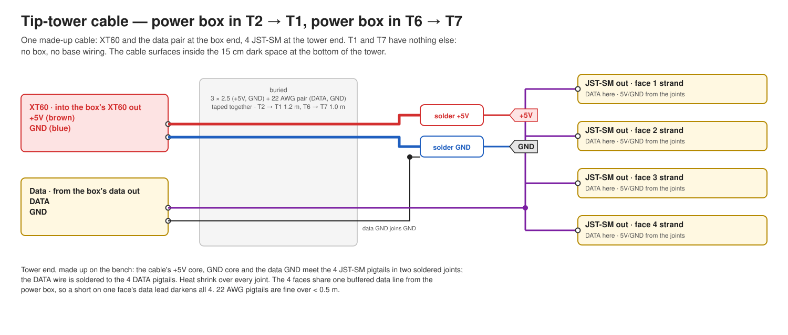

# Wiring

[← README](../README.md) · [Setup](setup.md) · [Build](build.md)

| Diagram | Covers |
|---|---|
| [System overview](img/overview.svg) | Both statues, boxes, cables |
| [Controller box](img/controller-wiring.svg) | Statue 1: ESP32, 2 × 74AHCT125, 7 transmitters, 3 jacks, 7 tower outputs |
| [Box 2](img/box2-wiring.svg) | Statue 2: 3 jacks, 7 receivers, 7 tower outputs |
| [Statue power](img/statue-power.svg) | Mains from the apex to 5 power boxes; which box feeds which tower |
| [Power box](img/power-box.svg) | All 10 power boxes: C14, PSU, own tower's splitter and 4 JST-SM, neighbour outputs |
| [Tip-tower cable](img/tip-tower-cable.svg) | Power box in T2 → T1, in T6 → T7: one cable, XT60 + data at the box, 4 JST-SM at the tower |

`+5V` / `GND` flags are the perfboard rails. Crossing lines without a dot are not connected.
RJ45 pigtail wires are drawn in T568B colours (striped = white/colour).

---

## Controller box (statue 1)

### ESP32 pins

| GPIO | Channel | Path |
|---|---|---|
| 4 | S1-T1 | 74AHCT125 #1 gate 1 → tower T1 data |
| 13 | S1-T2 | 74AHCT125 #1 gate 2 → tower T2 data |
| 14 | S1-T3 | 74AHCT125 #1 gate 3 → tower T3 data |
| 16 | S1-T4 | 74AHCT125 #1 gate 4 → tower T4 data |
| 17 | S1-T5 | 74AHCT125 #2 gate 1 → tower T5 data |
| 18 | S1-T6 | 74AHCT125 #2 gate 2 → tower T6 data |
| 19 | S1-T7 | 74AHCT125 #2 gate 3 → tower T7 data |
| 21 | S2-T1 | transmitter → jack 3 pins 4/5 (blue pair) |
| 22 | S2-T2 | transmitter → jack 3 pins 3/6 (green pair) |
| 23 | S2-T3 | transmitter → jack 3 pins 1/2 (orange pair) |
| 25 | S2-T4 | transmitter → jack 2 pins 1/2 (orange pair) |
| 26 | S2-T5 | transmitter → jack 2 pins 3/6 (green pair) |
| 27 | S2-T6 | transmitter → jack 1 pins 1/2 (orange pair) |
| 32 | S2-T7 | transmitter → jack 1 pins 3/6 (green pair) |
| 5V / VIN, GND | | perfboard rails |

GPIO 33 is spare.

### 74AHCT125 (×2, statue 1's towers)

| Pin | Connect to |
|---|---|
| 14 (VCC) | +5V |
| 7 (GND), 1/4/10/13 (OE) | GND |
| 2, 5, 9, 12 (1A–4A) | GPIOs per the table; on #2, pin 12 (unused 4A) → GND |
| 3, 6, 8, 11 (1Y–4Y) | 100 Ω (upright in the pin's row) → wire → tower data output |

The 74AHCT125s and 100 Ω resistors are optional, depending on perfboard space; without them
the GPIO drives the tower data output directly.

### MAX485 transmitters (×7)

| Module pin | Connect to |
|---|---|
| VCC | +5V |
| GND | GND |
| DI | its GPIO |
| DE and RE | both to +5V |
| RO | not connected |
| A, B | jack pigtail, per the RJ45 table |

Leave the module's own 120 Ω resistor in place.

---

## Box 2 (statue 2)

### MAX485 receivers (×7)

| Module pin | Connect to |
|---|---|
| A, B | jack pigtail, per the RJ45 table |
| VCC | +5V |
| GND | GND |
| DE and RE | both to GND |
| DI | not connected |
| RO | 100 Ω → tower data output |

**Idle bias, per receiver:** 560 Ω from **A to GND** and 560 Ω from **B to +5V**. Leave the
module's 120 Ω in place.

---

## RJ45 jacks and cables

Three channels per cable. Same pinout at both ends; cables are straight-through.

| Pin | Colour (T568B) | Signal |
|---|---|---|
| 1 | white/orange | channel 1, A |
| 2 | orange | channel 1, B |
| 3 | white/green | channel 2, A |
| 4 | blue | channel 3, B |
| 5 | white/blue | channel 3, A |
| 6 | green | channel 2, B |
| 7 | white/brown | GND |
| 8 | brown | GND |

| Jack | Channel 1 (orange) | Channel 2 (green) | Channel 3 (blue) |
|---|---|---|---|
| 1 | S2-T6 | S2-T7 | spare |
| 2 | S2-T4 | S2-T5 | spare |
| 3 | S2-T3 | S2-T2 | S2-T1 |

**Striped (white/colour) wire to A, solid colour to B, on every channel in both boxes.**
Pins 3/6 and 4/5 are each one twisted pair. Verify pin-to-pin with a meter through both
jacks; don't rely on colours.

---

## Power box (one-tower boxes in T3, T5; two-tower boxes in T2, T6; T4's is inside the apex box)

| Connection | To |
|---|---|
| Own tower data in (JST-SM) | DATA → 74AHCT125 #1 pins 2, 5, 9, 12, and 10 kΩ to GND; GND → GND; 5V pin not connected |
| 74AHCT125 #1 pins 3, 6, 8, 11 | 100 Ω → DATA of JST-SM out 1–4 (one per face) |
| JST-SM out 5V / GND | PSU +V / −V |
| Tip-tower data in (two-tower boxes only) | DATA → 74AHCT125 #2 gate 1, 10 kΩ to GND |
| 74AHCT125 #2 pin 3 | 100 Ω → tip-tower data out (22 AWG pair: DATA + GND) |
| 74AHCT125 VCC (14) / GND (7), OE (1, 4, 10, 13) | +5V / GND, GND; unused inputs to GND |
| XT60 out (two-tower boxes only) | PSU +V / −V, NYAF 2.5 mm² |
| XT60 out · top feed (every box) | PSU +V / −V, NYAF 2.5 mm² |

---

## Tip-tower cable (power box in T2 → T1, in T6 → T7)

One made-up cable per tip tower; T1 and T7 have no box and nothing to wire in the base.

- Box end: male XT60 into the box's XT60 out (+5 V brown, GND blue, 3 × 2.5) and the 22 AWG
  pair (DATA + GND) from the box's data out. The two run taped together in the trench.
- Tower end: 4 JST-SM out, one per strand. Two soldered joints: +5 V core → the 4 JST-SM 5V
  leads; GND core + data GND → the 4 JST-SM GND leads. DATA → the 4 JST-SM DATA leads.
- Heat shrink over every joint; nothing bare at the tower.

---

## Power

- **Mains:** outlet → extension cord → apex strip → extension cords chained tower to tower
  (apex → T3 → T2, apex → T5 → T6), a power strip at the end of each, and from apex 1 a cord
  on to apex 2. Each box: one short C13 cord from the strip in its own tower to its C14 (T4's
  box is at the apex strip). In each box: L → PSU 1, N → 2, PE → 3 (FG).
- **Strands:** every strand plugs into a JST-SM (5V, DATA, GND), at its own power box or at
  the end of the tip-tower cable.
- **Tip-tower cable (power box in T2 → T1, power box in T6 → T7):** 3 × 2.5 cable, brown +5 V,
  blue GND, green/yellow unused or GND, with the 22 AWG data pair taped to it. XT60 at the box
  end only; the tower end is the 4 JST-SM.
- **Top feed (T2–T6):** every strand of 75 LEDs or more gets 5 V / GND at its top end too.
  One cable per tower, 3 × 2.5 (brown +5 V, blue GND), from the box's top-feed XT60 up the
  post. At the top: two soldered joints (+5 V, GND), each the cable core with 4 NYAF 2.5 mm²
  tails to 4 female XT60s, one per strand top (male XT60 on the strip). Heat shrink over each
  joint. T1 and T7 have none.
- **Power box in T4 only:** PSU 5 (−V) / 7 (+V) → apex box perfboard rails, 0.5 mm².

---

## Notes

- Ferrules on stranded wire in screw terminals; stray strands short A to B. No tinned ends.
- No lever or screw splices anywhere else: wires that meet outside a terminal are soldered
  together, with heat shrink over the joint.
- Zip-tie the pigtails inside each box.
- Label box, jack, tower-output and tower numbers on both ends of every cable.
- MAX483/487/488/489 lookalikes are too slow for LED data; the chip must read MAX485.
